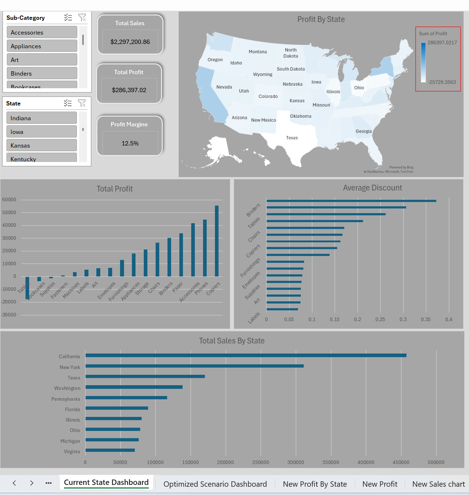
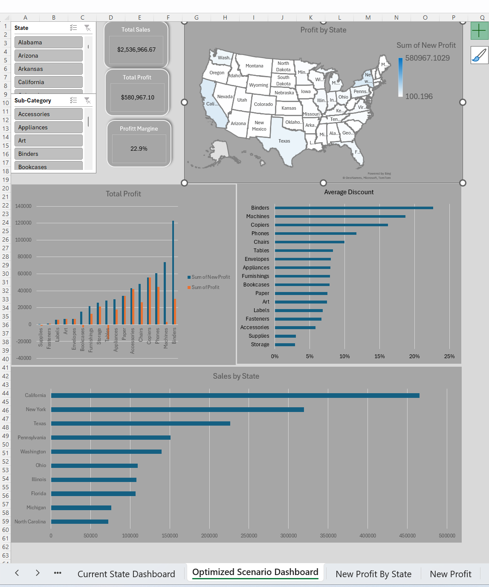

# 📊 Retail Profitability Optimization & Dynamic Pricing Analysis
*An End-to-End Business Intelligence Case Study Using Advanced Microsoft Excel*

---

## 📌 Executive Summary
In this analysis of **9,900+ retail transactions** totaling **$2.29M in revenue**, the business faced a critical operational paradox: sustained high sales volume coexisting with severely compressed net operating profits (**$286,397 net profit** at a **12.5% margin**).

Through systematic exploratory data analysis, this study revealed that uncontrolled promotional discounting—primarily concentrated within low-margin categories like **Tables** and **Bookcases**—was actively destroying capital and generating net operational losses.

By developing and testing an algorithmic **Break-Even Discount Cap Model**, the proposed strategic scenario demonstrates a projected net profit recovery to **$580,967** (**+102.8% net profit growth**) and expands profit margins to **22.9%**, without sacrificing baseline transaction velocity.

---

## 🖥️ Dashboard Architecture & Visual Interface

The deliverable is structured into two synchronized, interactive Excel dashboards styled with a corporate slate theme, removing default gridlines and system artifacts to provide a seamless executive BI experience.

### 1. Current State Dashboard (Diagnostic View)
* **Objective:** Detect revenue leakage points, margin destruction zones, and geographical vulnerabilities.
* **Core Visual Components:**
  * **Executive KPI Cards:** Baseline tracking of Revenue ($2.29M), Net Profit ($286.3K), and Overall Margin (12.5%).
  * **Geospatial Penetration Map:** State-level profit distribution identifying regional loss clusters.
  * **Bottom Sub-Category Profitability (Bar Chart):** Pinpoints heavy negative contributors (Tables: -$17.7K, Bookcases: -$3.4K).
  * **Discount Intensity by Sub-Category:** Directly correlates high average discounts to margin failures.
  * **Top 10 States by Sales:** Provides scale and volume context against profitability.

---

### 2. Optimized Scenario Dashboard (Strategic Solution)
* **Objective:** Quantify projected financial recovery achieved through the **Break-Even Discount Cap Model**.
* **Key Enhancements:**
  * **Dynamic Financial Upside:** Total optimized profit increases to $580.9K (+10.4 percentage points margin expansion to 22.9%).
  * **Comparative Performance (Before vs. After):** Side-by-side clustered columns verifying the elimination of operational losses in Furniture sub-categories.
  * **Geographic Health Restored:** Visual map confirmation demonstrating the elimination of net-loss territories.

---

## 🔍 Root Cause Diagnostic Analysis

Through targeted data segmentation, three core vulnerabilities were isolated:

### 1. The Furniture Discount Paradox
* **Tables:** Recorded **-$17,725.48** in cumulative losses.
  * *Threshold Analysis:* Transactions executed at **0% discount** yielded consistent positive profits across all states. However, crossing a **20% discount threshold** caused profit margins to collapse into severe operational deficits.
* **Bookcases:** Recorded **-$3,472.56** in losses.
  * *Threshold Analysis:* Profitability remained stable until discount rates exceeded **15%**, at which point fulfillment costs overtook realized revenue.

### 2. Geographic Inefficiencies
Heavy promotional discounting was heavily concentrated in specific states (such as Texas, Illinois, and Ohio), turning high transaction volumes into negative-margin liabilities.

---

## 🧮 Optimization Methodology & Mathematical Modeling

To eliminate loss-making sales without halting promotions entirely, a **Break-Even Pricing Model** was applied at the line-item transaction level:

1. **True Cost of Goods & Fulfillment:**
   $$\text{Cost} = \text{Sales} - \text{Profit}$$

2. **Original Baseline Sales (Pre-Discount):**
   $$\text{Original Sales} = \frac{\text{Sales}}{1 - \text{Discount}}$$

3. **Maximum Allowable Safe Discount (Break-Even Threshold):**
   $$\text{Max Safe Discount} = \max\left(0, 1 - \frac{\text{Cost}}{\text{Original Sales}}\right)$$

By establishing this boundary, any promotion exceeding the break-even threshold is restricted, guaranteeing that no transaction operates below a **$0 profit floor**.

---

## 🛠️ Technical Stack & Excel Features
* **Power Query:** Schema normalization, missing value remediation, and feature engineering (calculated fields: Net Price, Shipping Duration, Margin).
* **Advanced Pivot Tables & Slicers:** Dynamic multi-axis filtering connected across report dimensions (State, Sub-Category, Segment).
* **Dynamic KPI Component Design:** Integrated vector geometry linked dynamically to formula outputs.
* **Data Visualization & UX:** Horizontal sorted bar charts and heat-scaled thematic mapping.

---

## 💡 Strategic Recommendations for Management

1. **Implement Hard Promotional Caps:** Immediately limit promotional discounts on low-margin furniture items (maximum 10% on Tables and Bookcases).
2. **Product Bundling Strategy:** Restrict heavy discounts on furniture unless paired in a bundle with high-margin technology accessories (e.g., Phones, Copiers, Office Supplies).
3. **Fulfillment Surcharges for Heavy Items:** Re-evaluate freight costs on bulky items in geographically dispersed states to prevent negative net margins.
